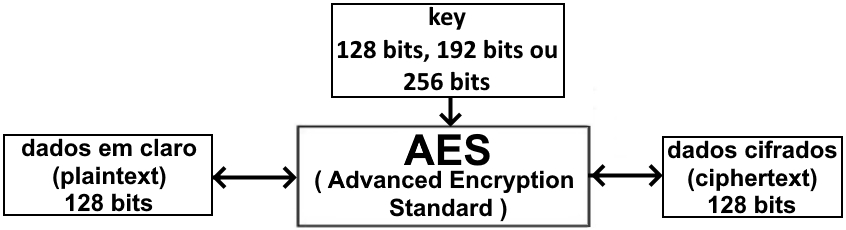
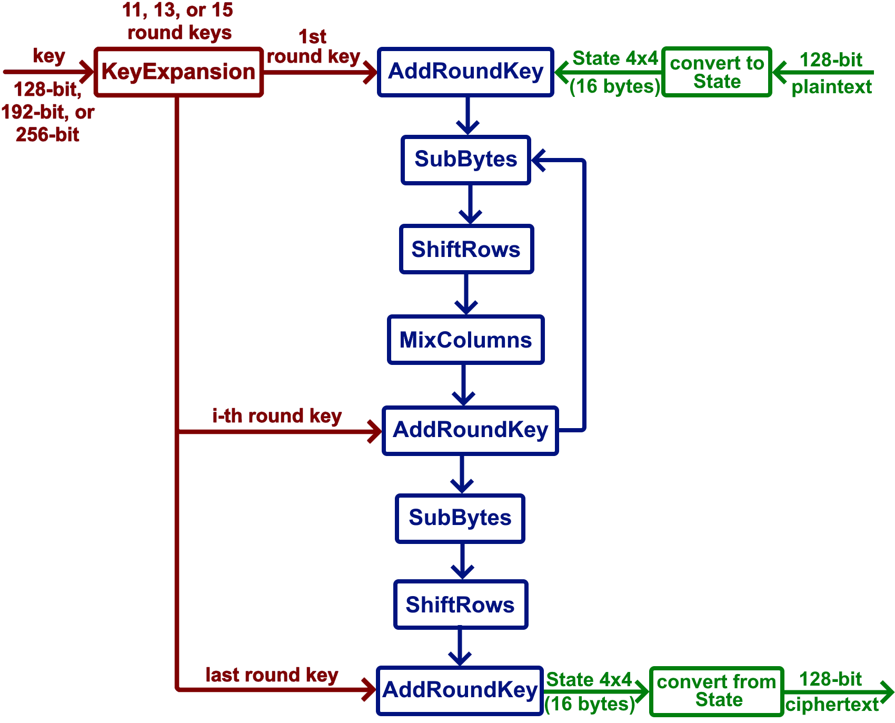
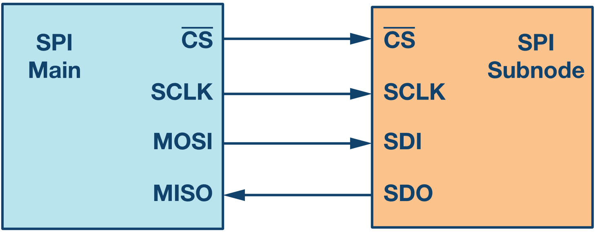
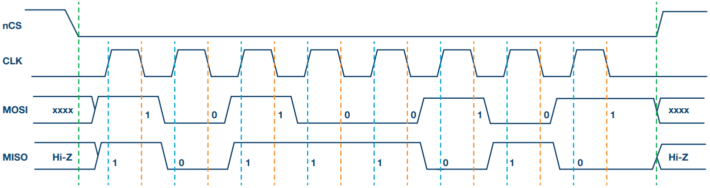
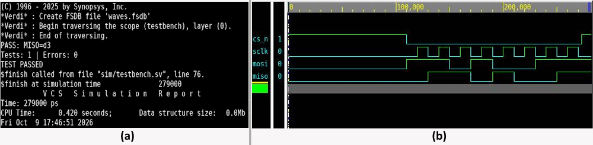

# Projeto Hands-on - RTL Design Track

## Relatório da Semana 1: Kick-off, estudo e ambiente

**Autor:** Apolo de Lima Silva  

**Status da semana:** aguardando avaliação do instrutor.

## 1. Atividades realizadas

### 1.1. Escopo e organização inicial

A primeira semana do projeto foi dedicada à apresentação do escopo geral, ao estudo inicial do algoritmo AES e do protocolo SPI, à preparação do ambiente de desenvolvimento e à organização do repositório e do backlog inicial.

O [backlog inicial](../backlog.md) foi criado com base nas principais etapas previstas para as 15 semanas do projeto.

### 1.2. Estudo do AES

O Advanced Encryption Standard (AES) é um algoritmo de criptografia simétrica padronizado pelo `National Institute of Standards and Technology` (NIST), agência do Departamento de Comércio dos Estados Unidos [1]. Podendo ser implementado tanto em software quanto em hardware, de forma geral, o AES recebe um bloco de dados e uma chave criptográfica (`key`) e gera uma saída cifrada (`encrypted`) ou decifrada (`decrypted`). No processo de cifragem, um bloco de dados em claro (`plaintext`) é transformado em um bloco de dados cifrados (`ciphertext`); no processo de decifragem, é realizada a transformação inversa (Figura 1).



*Figura 1 - Operação geral do AES.*

Com foco no processo de cifragem, o estudo e a presente descrição do AES foram realizados a partir da especificação apresentada pelo NIST [1].

O AES efetua o processo de criptografia sobre blocos de 128 bits do `plaintext`, utilizando uma `key` com tamanho de 128 bits, 192 bits ou 256 bits e funções para confusão e difusão do `State`. O tamanho da chave define o processo de expansão e a quantidade de rodadas de criptografia que serão aplicadas. O processo segue o diagrama apresentado na Figura 2.



*Figura 2 - Fluxo do processo de cifragem do AES.*

As etapas representadas na Figura 2 são descritas a seguir:

1. **Organização dos dados e expansão da chave:** Antes da cifragem, o *plaintext* de 128 bits é organizado em uma matriz 4 × 4 de 16 bytes, denominada *State*. Em paralelo, a chave original passa pela expansão de chave (*KeyExpansion*), responsável pela preparação das chaves de rodada (*round keys*). Cada chave de rodada possui 128 bits e pode ser representada como uma matriz 4 × 4 de bytes. São utilizadas 11 chaves de rodada no AES-128, 13 no AES-192 e 15 no AES-256, incluindo a chave aplicada na operação inicial.
2. **Operação inicial AddRoundKey:** No início da cifragem, os bytes do *State* são combinados com a primeira chave de rodada por meio de operações XOR. Essa operação antecede as rodadas principais.
3. **Execução das rodadas principais:** Após a operação inicial, são executadas repetidamente as transformações *SubBytes*, *ShiftRows*, *MixColumns* e *AddRoundKey*, nessa ordem. Em *SubBytes*, cada byte é substituído por outro valor por meio da tabela S-box. Em *ShiftRows*, as linhas do *State* são deslocadas ciclicamente por diferentes quantidades de posições, alterando a disposição dos bytes; a primeira linha permanece inalterada. Em *MixColumns*, cada coluna passa por uma transformação linear invertível que mistura os seus bytes. Por fim, *AddRoundKey* combina o *State* resultante com a chave correspondente à rodada atual. São executadas 9 rodadas principais no AES-128, 11 no AES-192 e 13 no AES-256.
4. **Rodada final:** A última rodada executa apenas *SubBytes*, *ShiftRows* e *AddRoundKey*, sem aplicar *MixColumns*.
5. **Formação da saída:** Após a última operação *AddRoundKey*, o *State* final é convertido novamente em um bloco de 128 bits, formando o *ciphertext*, que corresponde ao resultado da cifragem.

O estudo tem caráter introdutório e servirá como base para a definição da microarquitetura e a implementação do núcleo AES.

### 1.3. Estudo do protocolo SPI

O SPI (*Serial Peripheral Interface*) é uma interface serial síncrona de comunicação que permite a troca de dados entre um controlador e um ou mais periféricos [2]. Um barramento SPI permite que o controlador (também chamado de `main` ou `master`) estabeleça uma comunicação *full-duplex* e de alta velocidade com os periféricos que compartilham o barramento (também chamados de `subnodes` ou `slaves`) [3].

A Figura 3 apresenta uma configuração SPI com quatro sinais: SCLK, CS_N, MOSI e MISO.



*Figura 3 - Configuração básica SPI. Fonte: Dhaker (2018) [2].*

- SCLK (*Serial Clock*) — sinal de clock da comunicação;
- CS_N (*Chip Select*) — sinal de seleção do dispositivo;
- MOSI (*Main Out, Subnode In*) — linha de dados do controlador para o periférico;
- MISO (*Main In, Subnode Out*) — linha de dados do periférico para o controlador.

No processo de transmissão, inicialmente, o `main` seleciona o `subnode` com o qual deseja se comunicar por meio da ativação da linha CS, normalmente ativa em nível baixo. O sinal de clock `SCLK` é utilizado para sincronizar o `main` e o `subnode`. Como a comunicação SPI é *full-duplex*, é possível receber e transmitir dados simultaneamente. Além disso, o estado de `SCLK` em repouso (*idle*), quando não há transmissão, é definido pelo valor de `CPOL` (*Clock Polarity*), bit de configuração do SPI. Outro bit de configuração, chamado `CPHA` (*Clock Phase*), determina as bordas do clock utilizadas para amostrar os dados recebidos pela linha `MOSI` e atualizar os bits transmitidos pela linha `MISO`, por meio dos registradores de deslocamento do SPI. Combinados, `CPOL` e `CPHA` definem os quatro modos de operação da interface SPI, apresentados na Tabela 1.


| Modo SPI | CPOL | CPHA | SCLK em repouso | Amostragem de MOSI | Deslocamento para MISO |
| -------- | ---- | ---- | --------------- | ------------------ | ---------------------- |
| 0        | 0    | 0    | Nível baixo    | Borda de subida    | Borda de descida       |
| 1        | 0    | 1    | Nível baixo    | Borda de descida   | Borda de subida        |
| 2        | 1    | 0    | Nível alto     | Borda de descida   | Borda de subida        |
| 3        | 1    | 1    | Nível alto     | Borda de subida    | Borda de descida       |

*Tabela 1 - Modos de transferência SPI. Adaptada de Dhaker (2018) [2].*

A Figura 4 apresenta um exemplo do formato de onda das quatro linhas SPI para o modo 1 da Tabela 1. Nesse modo, o sinal `SCLK` permanece em nível baixo durante o repouso. O início e o fim da transmissão são determinados pelas transições de nível alto para baixo e de baixo para alto do sinal CS, respectivamente, indicadas pelas linhas verdes tracejadas. Durante a transmissão, os dados nas linhas `MOSI` e `MISO` são deslocados na borda de subida do clock (linhas azuis) e amostrados na borda de descida (linhas laranjas).



*Figura 4 - SPI modo 1: CPOL = 0 e CPHA = 1. Fonte: Dhaker (2018) [2].*

Esses conceitos serão utilizados na implementação da interface SPI e na definição da travessia entre os domínios de clock do SPI e do sistema, em conjunto com outras fontes bibliográficas e recomendações do instrutor.

### 1.4. Arquitetura-base do sistema

A arquitetura-base apresentada pelo instrutor integra os blocos RESET, PLL, SPI, AES e MEMORY / DATA System, além do modelo de memória. O sistema atua como periférico SPI (`slave`), enquanto um microcontrolador ou microprocessador externo atua como controlador (`master`).

As quatro interfaces de topo estabelecem a conexão do sistema com o ambiente externo. A tabela a seguir identifica essas interfaces e explica sua participação no reset, na geração do clock, na configuração e na transferência dos dados.


| Interface de topo | Função na arquitetura-base                                                                      |
| ----------------- | ------------------------------------------------------------------------------------------------- |
| GLOBAL RESET      | reset externo, tratado pelo bloco RESET.                                                          |
| clk from OSC      | clock externo utilizado pelo modelo do PLL para gerar o clock do sistema.                         |
| SPI IF            | interface externa para configuração, controle e leitura de status do sistema.                   |
| MEMORY DATA IF    | entrada e a saída dos dados processados pelo AES, por meio do subsistema de dados e da memória. |

O SPI opera no domínio SCLK, enquanto o banco de registradores e a interface com o AES operam no domínio do sistema. A estratégia de travessia entre esses domínios e o tratamento dos resets serão detalhados na semana 2. Os modelos comportamentais do PLL e da memória ficam em `models/`, separados do RTL sintetizável [4].

### 1.5. Preparação do ambiente

A estrutura inicial do repositório foi preparada para separar os principais arquivos do projeto, incluindo código RTL, testbench e documentação.

```text
.
├── README.md
├── Makefile
├── docs/
│   ├── spec/
│   ├── architecture/
│   ├── reports/
│   │   ├── semana_01.md
│   │   └── images/
│   │       └── semana_01/
│   └── backlog.md
├── rtl/
│   ├── aes/
│   │   ├── aes_main.sv
│   │   └── round_fsm.sv
│   ├── spi/
│   │   ├── spi_subnode.sv
│   │   ├── spi_base.sv
│   │   ├── spi_cdc.sv
│   │   └── reg_bank.sv
│   ├── aes_spi_pkg.sv
│   ├── aes_top.sv
│   ├── reset_ctrl.sv
│   └── power_ctrl.sv
├── sim/
│   ├── testbench.sv
│   ├── stimulus.sv
│   └── response_checker.sv
├── models/
│   ├── pll_model.sv
│   └── memory_model.sv
├── libs/
├── synth/
├── fm/
└── upf/
```

Função proposta para cada módulo RTL:

- `aes_spi_pkg.sv`: define os parâmetros compartilhados;
- `aes_top.sv`: instancia e interconecta os módulos do sistema;
- `aes_main.sv`: implementa o núcleo AES e suas transformações;
- `round_fsm.sv`: controla o sequenciamento das rodadas e funções do AES;
- `spi_main.sv`: integra os componentes da SPI;
- `spi_base.sv`: controla as operações da SPI;
- `spi_cdc.sv`: realiza a travessia entre os domínios `SCLK` e `clk_sys`;
- `reg_bank.sv`: armazena registradores de configuração, controle e status;
- `reset_ctrl.sv`: gerencia os sinais de reset do sistema;
- `power_ctrl.sv`: controla os modos e as sequências de gerenciamento de energia;
- `pll_model.sv`: representa a PLL na simulação;
- `memory_model.sv`: fornece a interface com o modelo de memória definido.

Função proposta para cada módulo de verificação:

- `testbench.sv`: instancia o DUT (*Design Under Test*), conecta os sinais e coordena os testes;
- `stimulus.sv`: gera os estímulos enviados ao DUT;
- `response_checker.sv`: verifica as respostas do DUT, compara os resultados obtidos com os valores esperados e gera mensagens de erro em caso de divergências.

## 2. Resultados obtidos

Os resultados registrados até o momento são:

- backlog inicial criado;
- estudo introdutório do AES e do SPI concluído;
- arquitetura-base resumida neste relatório;
- repositório inicial estruturado;
- teste mínimo de eco executado em simulação, com 1 teste, 0 erros e `TEST PASSED`.

No teste mínimo, a palavra `8'hD3` é enviada por MOSI, com o bit mais significativo primeiro. Cada bit é capturado na subida de SCLK e devolvido por MISO na descida seguinte. O `response_checker` lê MISO após um atraso de 1 ns e compara a palavra recebida com a enviada. A Figura 5 apresenta o resultado da simulação do teste mínimo de eco (a) e as formas de onda visualizadas no Verdi (b).



*Figura 5 - Resultados do teste mínimo de eco: (a) saída da simulação no VCS, com 1 teste, 0 erros e `TEST PASSED`; (b) formas de onda de MOSI, MISO e SCLK visualizadas no Verdi.*

## 3. Problemas encontrados

Não foram registrados erros no teste mínimo de eco executado, nem foram encontradas outras dificuldades.

## 4. Próximos passos

Abaixo temos listado as atividades previstas para a semana 02:

- diagrama de blocos e interfaces de topo e internas;
- interfaces dos modelos do PLL e da memória, compatíveis com as utilizadas pelo verificador parceiro;
- mapa de registradores e interface de controle, status, chave e dados do núcleo AES;
- estratégia de clock, reset e travessia entre SCLK e o domínio do sistema;
- escolha e justificativa da microarquitetura do AES;
- apresentação da arquitetura ao verificador parceiro e defesa para aprovação pelo instrutor.

## Referências

1. **NIST.** *Advanced Encryption Standard (AES).* FIPS 197. Washington, D.C., 2001. Atualizado em 9 maio 2023. DOI: [10.6028/NIST.FIPS.197-upd1](https://doi.org/10.6028/NIST.FIPS.197-upd1). Acesso em: 7 out. 2026.
2. **DHAKER, P.** *Introduction to SPI Interface.* Analog Dialogue, v. 52, n. 9, set. 2018. Disponível em: [Analog Devices](https://www.analog.com/en/resources/analog-dialogue/articles/introduction-to-spi-interface.html). Acesso em: 8 out. 2026.
3. **PAN, Y.** *Understanding the SPI Bus.* Texas Instruments, SBOA621, ago. 2025. Disponível em: [documento SBOA621](https://www.ti.com/lit/ab/sboa621/sboa621.pdf). Acesso em: 8 out. 2026.
4. **MATERIAL DO INSTRUTOR.** *Projeto Hands-on - RTL Design Track: Acelerador AES com interface SPI e baixo consumo.* Documento de planejamento fornecido para o projeto, 2026.

