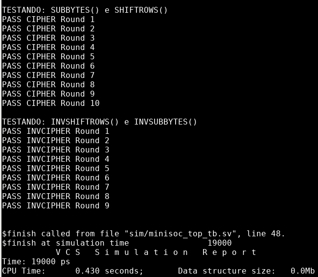

# Relatório da semana 02 — Arquitetura e microarquitetura

## 1. Diagrama e interface: Interfaces de topo e entre módulos

As interfaces externas (`RESET`, `CLK`, `SPI IF` e `MEMORY DATA IF`) e as conexões internas são representadas no diagrama de [microarquitetura_v1.0.md](../architecture/microarquitetura_v1.0.md).

A memória de dados é compartilhada entre o AES e a interface externa, com acesso exclusivo selecionado por `MEM_SEL_AES` (`system_control[0]`). O sequenciamento do reset é realizado diretamente no topo, sem módulo dedicado.

As interfaces externas seguem a especificação em [DV_BlockGuide_MiniSoCAES_v1.0.0](../../docs/spec/DV_BlockGuide_MiniSoCAES_v1.0.0.pdf).

## 2. State matrix 4x4

A organização dos 16 bytes na matriz AES é apresentada na Tabela 1.

**Tabela 1 — Organização dos bytes da matriz State.**

| | Coluna 0 | Coluna 1 | Coluna 2 | Coluna 3 |
|---|---|---|---|---|
| **Linha 0** | B0 `[127:120]` | B4 `[95:88]` | B8 `[63:56]` | B12 `[31:24]` |
| **Linha 1** | B1 `[119:112]` | B5 `[87:80]` | B9 `[55:48]` | B13 `[23:16]` |
| **Linha 2** | B2 `[111:104]` | B6 `[79:72]` | B10 `[47:40]` | B14 `[15:8]` |
| **Linha 3** | B3 `[103:96]` | B7 `[71:64]` | B11 `[39:32]` | B15 `[7:0]` |

## 3. Implementação de `minisoc_aes_sbox` e `minisoc_aes_sub_bytes`

O módulo `minisoc_aes_sub_bytes` realiza as operações SubBytes e InvSubBytes utilizando 16 instâncias de `minisoc_aes_sbox`, uma para cada byte do State. Cada instância contém duas tabelas de consulta (*Look-Up Tables* — LUTs), direta e inversa, com 256 entradas de 8 bits cada, conforme as Tabelas 4 e 6 da FIPS 197, respectivamente [1].

Os 16 bytes do State são processados em paralelo, por lógica puramente combinacional. O sinal `sel_mode` define a operação (0 para SubBytes e 1 para InvSubBytes), e o resultado é disponibilizado em `state_out`, sem necessidade de clock ou sinais de controle.

## 4. Implementação de `minisoc_aes_shift_rows`

O módulo `minisoc_aes_shift_rows` realiza as operações ShiftRows e InvShiftRows por meio do deslocamento circular dos bytes das linhas do State, conforme as Seções 5.1.2 e 5.3.1 da FIPS 197, respectivamente [1]. A organização dos 16 bytes na matriz AES é apresentada na Tabela 1.

Os bytes das quatro linhas são reordenados simultaneamente por lógica combinacional. O sinal `sel_mode` seleciona ShiftRows (0), com deslocamentos circulares à esquerda, ou InvShiftRows (1), com deslocamentos à direita. A primeira linha permanece inalterada, enquanto as demais são deslocadas em uma, duas ou três posições, respectivamente. O resultado é disponibilizado em `state_out`, sem depender de ciclos de clock.

## 5. Testbench autoverificável

O testbench autoverificável compara os resultados de [`minisoc_aes_sub_bytes.sv`](../../rtl/minisoc_aes/minisoc_aes_sub_bytes.sv) e [`minisoc_aes_shift_rows.sv`](../../rtl/minisoc_aes/minisoc_aes_shift_rows.sv) com os estados intermediários do exemplo de cifragem do Apêndice B da FIPS 197 [1]. Os módulos são encadeados na ordem SubBytes → ShiftRows para `sel_mode = 0` e InvShiftRows → InvSubBytes para `sel_mode = 1`.
Os testes foram executados nas dez rodadas, com resultado `PASS` em cada uma.

*Figura 1 — Resultado do testbench autoverificável.*

## 6. Lista de dúvidas

1. **Clock do módulo SPI:** Segundo a especificação, o módulo SPI deve operar no domínio *always-on*, utilizando o clock de referência `clk`, independentemente do PLL? O módulo `minisoc_pll_mock.sv` deve permanecer como modelo RTL para simulação ou está prevista sua substituição por uma macro de PLL (*Hard IP*) ?

2. **Clock-domain crossing :** O banco de registradores SPI é atualizado pelo clock *always-on* (`clk`), enquanto o AES utiliza o clock de sistema (`sys_clk`)?

3. **Implementação combinacional ou sequencial:** A lógica implementada em `minisoc_aes_sub_bytes.sv` e `minisoc_aes_shift_rows.sv` deve ser estritamente combinacional ou pode ser sequencial?

4. **Configuração do tamanho da chave AES:** Seria possível implementar uma configuração dinâmica do tamanho da chave utilizando bits reservados do registrador `AES_CONTROL`?

## Referências

1. **NIST.** *Advanced Encryption Standard (AES).* FIPS 197. Washington, D.C., 2001. Atualizado em 9 maio 2023. DOI: [10.6028/NIST.FIPS.197-upd1](https://doi.org/10.6028/NIST.FIPS.197-upd1). Acesso em: 7 out. 2026.

