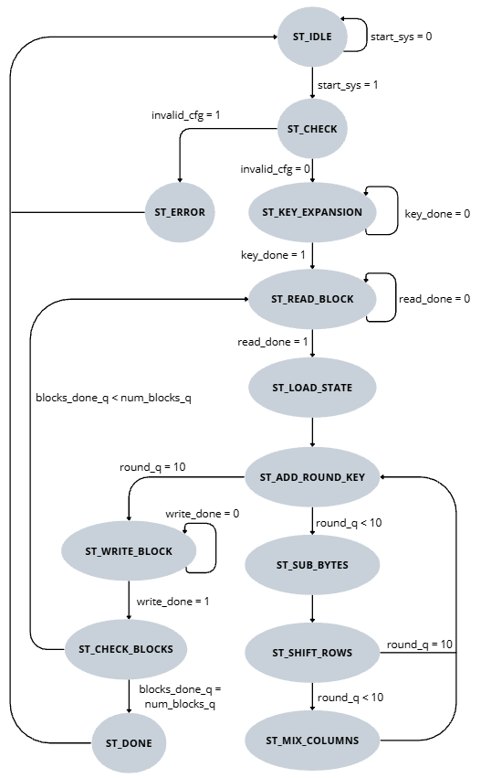
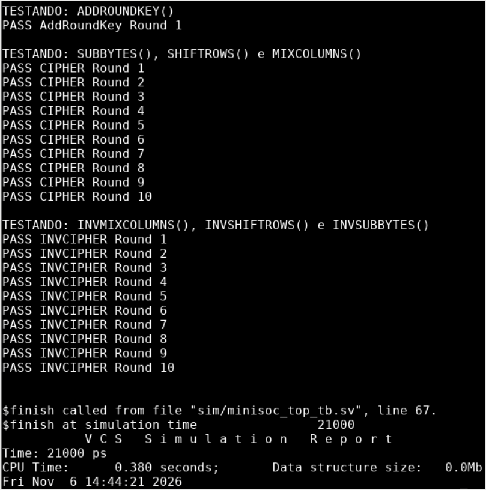

# Relatório da semana 03 — Microarquitetura e transformações de rodada

Nesta semana, foi definida a organização do núcleo AES, incluindo as interfaces entre a expansão de chave, o datapath, o controle de memória e a FSM. Também foram implementadas as transformações restantes e realizada sua verificação.

As interfaces externas e a microarquitetura seguem a especificação em [DV_BlockGuide_MiniSoCAES_v1.0.0](../../docs/spec/DV_BlockGuide_MiniSoCAES_v1.0.0.pdf), preservando os nomes e as larguras definidos.

## 1. Diagrama e interfaces de topo e entre módulos

As interfaces externas (`RESET`, `CLK`, `SPI IF` e `MEMORY DATA IF`) e as conexões internas são representadas no diagrama em blocos de [microarquitetura_v1.0.md](../architecture/microarquitetura_v1.0.md).

A memória de dados é compartilhada entre o AES e a interface externa, com acesso exclusivo selecionado por `MEM_SEL_AES` (`system_control[0]`). O sequenciamento do reset é realizado diretamente no topo, sem módulo dedicado.

## 2. Microarquitetura do núcleo AES

`minisoc_aes_top` organiza a operação do AES, coordena a expansão da chave, controla as rodadas utilizando uma FSM Moore, define a lógica de acesso à memória e forma `aes_status`. A expansão de chave e o processamento do bloco de 128 bits pertencem, respectivamente, a [`minisoc_aes_key_exp.sv`](../../rtl/minisoc_aes/minisoc_aes_key_exp.sv) e [`minisoc_aes_dp.sv`](../../rtl/minisoc_aes/minisoc_aes_dp.sv). O topo instancia esses dois módulos; sua implementação completa está prevista para a Semana 4.

### 2.1 Verificação da configuração e lógica de início

A lógica de início e a verificação da configuração foram definidas na Semana 3.

1. `start_sys` representa o comando `AES_CONTROL.START`, definido como *write-one-pulse*. 
2. Em `ST_CHECK`, `invalid_cfg` verifica se `NUM_BLOCKS` é igual a zero ou superior a 256, ou se `MODE` é superior a 5.
3. Uma configuração inválida leva a `ST_ERROR` e bloqueia `key_start`; uma configuração válida permite iniciar a expansão da chave.

### 2.2 Expansão de chave

Com implementação prevista para a Semana 4, apenas a interface de conexão de [`minisoc_aes_key_exp.sv`](../../rtl/minisoc_aes/minisoc_aes_key_exp.sv) com [`minisoc_aes_top.sv`](../../rtl/minisoc_aes/minisoc_aes_top.sv) e a sequência de controle da expansão foram definidas na Semana 3.

1. `minisoc_aes_key_exp` recebe a chave AES original de 128 bits armazenada em `key_q` (que recebe a chave em cfg_key quando `start_sys` é acionado).
2. `key_start` permite a expansão apenas quando as configurações são válidas durante o estado `ST_CHECK`, e a FSM permanece em `ST_KEY_EXPANSION` até `key_done` indicar sua conclusão.
3. `round_q` seleciona a chave de rodada disponibilizada em `round_key`.

A implementação de [`minisoc_aes_key_exp.sv`](../../rtl/minisoc_aes/minisoc_aes_key_exp.sv) deve fornecer as chaves das rodadas 0 a 10 conforme `round_q` mudar.

### 2.3 Datapath AES

Com implementação prevista para a Semana 4, apenas a interface de conexão de [`minisoc_aes_dp.sv`](../../rtl/minisoc_aes/minisoc_aes_dp.sv) com [`minisoc_aes_top.sv`](../../rtl/minisoc_aes/minisoc_aes_top.sv) e a escolha da lógica do datapath foram definidas na Semana 3.

1. `minisoc_aes_dp` recebe o bloco de 128 bits montado em `memory_block_q` a partir de quatro leituras da memória.
2. De acordo com o estado da FSM `state_q` e o número da rodada `round_q`, processa o bloco usando a chave de rodada `round_key` na etapa de cifragem ou decifragem correspondente e salva valores intermediários.
3. No final do processo, retorna o bloco resultante em `result_block`.

### 2.4 FSM e execução de rodadas

A Figura 1 apresenta a máquina de estados do tipo Moore proposta para controlar a cifragem AES-128. A sequência ainda será adaptada para a decifragem.



*Figura 1 — Diagrama de estados da FSM para cifragem AES-128.*

A tabela a seguir resume a função dos estados e das sequências de estados.

| Estado ou sequência | Papel no processamento |
|---|---|
| `ST_IDLE` → `ST_CHECK` | Receber o início, capturar a configuração e verificar seus valores. |
| `ST_KEY_EXPANSION` | Aguardar as chaves de rodada. |
| `ST_READ_BLOCK` → `ST_LOAD_STATE` | Reunir quatro palavras da memória e carregar o bloco no State. |
| `ST_ADD_ROUND_KEY`, rodada 0 | Aplicar a chave inicial. |
| `ST_SUB_BYTES` → `ST_SHIFT_ROWS` → `ST_MIX_COLUMNS` → `ST_ADD_ROUND_KEY`, rodadas 1 a 9 | Executar as rodadas intermediárias. |
| `ST_SUB_BYTES` → `ST_SHIFT_ROWS` → `ST_ADD_ROUND_KEY`, rodada 10 | Executar a rodada final sem MixColumns. |
| `ST_WRITE_BLOCK` → `ST_CHECK_BLOCKS` | Escrever quatro palavras e verificar se há outro bloco. |
| `ST_DONE` ou `ST_ERROR` | Indicar conclusão ou configuração inválida e retornar a `ST_IDLE`. |

`round_q` seleciona as chaves das rodadas 0 a 10. Após a quarta escrita, `blocks_done_q` é incrementado. `ST_CHECK_BLOCKS` compara essa contagem com `num_blocks_q`: se ainda houver blocos, a FSM volta a `ST_READ_BLOCK`; caso contrário, segue para `ST_DONE`.

### 2.5 Interface e controle de leitura e escrita da memória

Em [`minisoc_top.sv`](../../rtl/minisoc_top.sv), o acesso à memória compartilhada deve ser controlado por um multiplexador (*Mem Mux*), responsável por selecionar entre o AES Engine e a interface externa MEMORY DATA. A seleção é realizada pelo sinal `mem_sel_aes`, correspondente ao bit 0 do registrador `SYSTEM_CONTROL`. Quando `mem_sel_aes = 0`, a memória é controlada pela interface externa; quando `mem_sel_aes = 1`, o controle é transferido ao AES Engine, conforme a seção 7.2 do *Block Guide* [2]. A implementação do multiplexador está prevista para a Semana 7.

```text
                     mem_sel_aes = system_control[0]
                                  |
                                  v
                        +-----------------------+
sys_clk (1) ----------->|                       |
mem_clk (0) ----------->|                       |----> mem_mux_clk
                        |                       |
aes_mem_we (1) -------->|                       |
mem_i_wr_en (0) ------->|                       |----> mem_mux_we
                        |                       |
aes_mem_addr (1) ------>|     MEM MUX (2:1)     |
mem_i_addr (0) -------->|                       |----> mem_mux_addr
                        |                       |
aes_mem_wdata (1) ----->|                       |
mem_i_data (0) -------->|                       |----> mem_mux_wdata
                        |                       |
                        +-----------------------+
```

*Figura 2 — Multiplexador de acesso à memória compartilhada.*

Os índices (0) e (1) identificam os sinais selecionados por `mem_sel_aes`. As saídas do multiplexador são encaminhadas à memória; o dado retornado (`mem_mux_rdata`) é disponibilizado a `aes_mem_rdata` e `mem_o_data`. 

Já em [`minisoc_aes_top.sv`](../../rtl/minisoc_aes/minisoc_aes_top.sv), é definido o controle interno de acesso à memória. Os registradores `block_q` e `word_q` são utilizados para formar o endereço de acesso. O endereço de 10 bits é composto pela concatenação `{block_q[7:0], word_q}`.

```text
 9                        2 1            0
+--------------------------+--------------+
|      block_q[7:0]        | word_q[1:0]  |
+--------------------------+--------------+
          8 bits                2 bits
```

*Figura 3 — Divisão do endereço de memória do AES.*

| Registrador | Função | Valores |
|---|---|---|
| `block_q` | Seleciona o bloco AES de 128 bits em processamento. | 0 a 255 |
| `word_q` | Seleciona uma das quatro palavras de 32 bits do bloco. | 0 a 3 |

A memória contém 1024 palavras de 32 bits, de modo que cada bloco AES de 128 bits ocupa quatro endereços consecutivos. O registrador `block_q` seleciona o bloco, enquanto `word_q` identifica a palavra dentro dele.

A interface de escrita utiliza os seguintes sinais:

- `mem_addr`: endereço da palavra na memória, formado por `{block_q[7:0], word_q}`.
- `mem_we`: sinal de habilitação de escrita, ativado durante o estado `ST_WRITE_BLOCK`.
- `mem_wdata`: palavra de 32 bits selecionada de `result_block`, por meio da expressão `result_block[127 - 32*word_q -: 32]`.

A seleção de `mem_wdata` depende do valor de `word_q`, conforme a tabela:

| `word_q` | Bits de `result_block` | Endereço relativo |
|---|---|---|
| 0 | `[127:96]` | `base + 0` |
| 1 | `[95:64]` | `base + 1` |
| 2 | `[63:32]` | `base + 2` |
| 3 | `[31:0]` | `base + 3` |

Durante `ST_READ_BLOCK`, as quatro palavras serão lidas sequencialmente da memória e armazenadas em `memory_block_q`, formando o bloco de 128 bits. Após o processamento AES, o estado `ST_WRITE_BLOCK` realizará a escrita das quatro palavras de `result_block` nos mesmos endereços, caracterizando o processamento *in-place* previsto na especificação [1,2].

Nesta etapa, foram definidos os sinais de interface e o mapeamento de endereços. A lógica sequencial de atualização de `word_q` e `block_q`, a temporização das leituras síncronas e a geração de `read_done` e `write_done` serão implementadas na Semana 6.

### 2.6 Saída de status

A organização de `aes_status` e as condições de atualização dos indicadores foram definidas 
em m [`minisoc_aes_top.sv`](../../rtl/minisoc_aes/minisoc_aes_top.sv), conforme:

1. `aes_status` reúne `BUSY` no bit 0, `DONE` no bit 1, `ERROR` no bit 2 e `BLOCKS_DONE` nos bits `[11:3]`.
2. `blocks_done_q` é incrementado após a escrita completa de cada bloco. `DONE` é acionado em `ST_DONE` e limpo quando um novo `START` válido é aceito.
3. `ERROR` é acionado quando `ST_CHECK` detecta uma configuração inválida e permanece ativo até o reset, conforme a lógica proposta.

## 3. Sequência de reset e comunicação entre domínios de clock

A sequência de reset do núcleo AES é definida em [`minisoc_top.sv`](../../rtl/minisoc_top.sv). A lógica foi definida para `RESET_RELEASE_CYCLES = 2`.

| `rst_n` | `o_locked` | `rst_release_n` | Situação |
|---|---|---|---|
| 0 | 0 | 0 | Reset ativo |
| 0 | 1 | 0 | Reset ativo |
| 1 | 0 | 0 | Reset ativo |
| 1 | 1 | 1 | Liberação permitida |

O domínio AES só poderá sair do reset quando o PLL estiver travado e transcorrerem dois ciclos de `sys_clk` para a liberação síncrona de `rst_sys_n`, com asserção assíncrona usando o sinal intermediário `rst_release_n`.

## 4. Implementação de `minisoc_aes_mix_columns`

O módulo [`minisoc_aes_mix_columns.sv`](../../rtl/minisoc_aes/minisoc_aes_mix_columns.sv) realiza as operações MixColumns() e InvMixColumns() por meio da multiplicação de cada coluna do State por uma matriz fixa no campo finito GF(2⁸), conforme as Seções 5.1.3 e 5.3.3 da FIPS 197, respectivamente [1].

Para cada coluna \(c\), MixColumns é definido pela Equação (5.7):

$$
\begin{bmatrix}
s'_{0,c}\\ s'_{1,c}\\ s'_{2,c}\\ s'_{3,c}
\end{bmatrix}
=
\begin{bmatrix}
02 & 03 & 01 & 01\\
01 & 02 & 03 & 01\\
01 & 01 & 02 & 03\\
03 & 01 & 01 & 02
\end{bmatrix}
\begin{bmatrix}
s_{0,c}\\ s_{1,c}\\ s_{2,c}\\ s_{3,c}
\end{bmatrix}.
$$

InvMixColumns é definido pela Equação (5.14):

$$
\begin{bmatrix}
s'_{0,c}\\ s'_{1,c}\\ s'_{2,c}\\ s'_{3,c}
\end{bmatrix}
=
\begin{bmatrix}
0e & 0b & 0d & 09\\
09 & 0e & 0b & 0d\\
0d & 09 & 0e & 0b\\
0b & 0d & 09 & 0e
\end{bmatrix}
\begin{bmatrix}
s_{0,c}\\ s_{1,c}\\ s_{2,c}\\ s_{3,c}
\end{bmatrix}.
$$

Os quatro bytes de cada coluna são combinados por lógica combinacional. O sinal `sel_mode` seleciona MixColumns (`0`), com coeficientes `{02, 03, 01, 01}`, ou InvMixColumns (`1`), com coeficientes `{0e, 0b, 0d, 09}` na primeira linha de suas respectivas matrizes. O resultado é disponibilizado em `state_out`.

## 5. Testbench autoverificável

O testbench autoverificável compara os resultados de [`minisoc_aes_sub_bytes.sv`](../../rtl/minisoc_aes/minisoc_aes_sub_bytes.sv), [`minisoc_aes_shift_rows.sv`](../../rtl/minisoc_aes/minisoc_aes_shift_rows.sv) e [`minisoc_aes_mix_columns.sv`](../../rtl/minisoc_aes/minisoc_aes_mix_columns.sv) com os estados intermediários do exemplo de cifragem do Apêndice B da FIPS 197 [1]. Os módulos são encadeados na ordem SubBytes → ShiftRows → MixColumns para `sel_mode = 0` e InvMixColumns → InvShiftRows → InvSubBytes para `sel_mode = 1`, de modo a reverter essa sequência de transformações.

Com exceção da rodada 10, na qual MixColumns não é aplicada, os testes contemplaram as transformações das dez rodadas, com resultado `PASS` em cada uma, conforme o registro apresentado a seguir.



*Figura 4 — Resultado do testbench autoverificável.*

## 6. Lista de dúvidas

1. 1. A lógica de CDC deve ficar em `minisoc_spi.sv` ou em `minisoc_aes_top.sv`? ?


2. Considerando a existência de três domínios de clock:

- **Domínio SPI (`spi_sclk`):** recepção dos comandos SPI.
- **Domínio always-on (`clk`):** banco de registradores.
- **Domínio AES (`clk_sys`):** processamento aes.

Será necessário implementar duas lógicas de CDC independentes, conforme exemplificado na Figura 5 ?

```text
Domínio SPI         Domínio always-on        Domínio AES
(spi_sclk)               (clk)               (clk_sys)
     │                     │                     │
     ▼                     ▼                     ▼
┌───────────┐       ┌──────────────┐       ┌────────────┐
│ Recepção  │       │  Banco de    │       │            │
│   SPI     │       │ registradores│       │ Núcleo AES │
└─────┬─────┘       └──────┬───────┘       └──────▲─────┘
      │                    │                      │
      ▼                    ▼                      │
    CDC 1                CDC 2 ──────────────────┘
      │                    ▲
      └────────────────────┘
```

*Figura 5 — Representação conceitual proposta das duas fronteiras de CDC entre os domínios de clock do MiniSoC AES.*


## Referências

1. **NIST.** *Advanced Encryption Standard (AES).* FIPS 197. Washington, D.C., 2001. Atualizado em 9 maio 2023. DOI: [10.6028/NIST.FIPS.197-upd1](https://doi.org/10.6028/NIST.FIPS.197-upd1). Acesso em: 7 out. 2026.
2. **MiniSoC AES.** *DV_BlockGuide_MiniSoCAES*, v1.0.0. Especificação do projeto.
