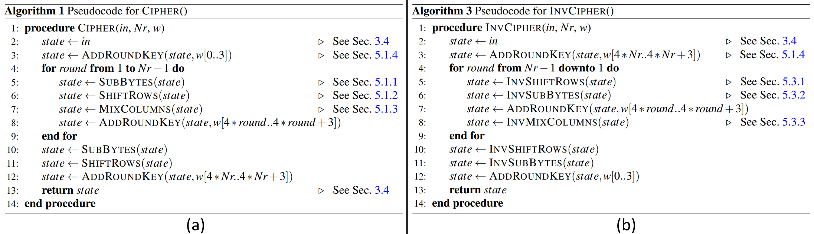
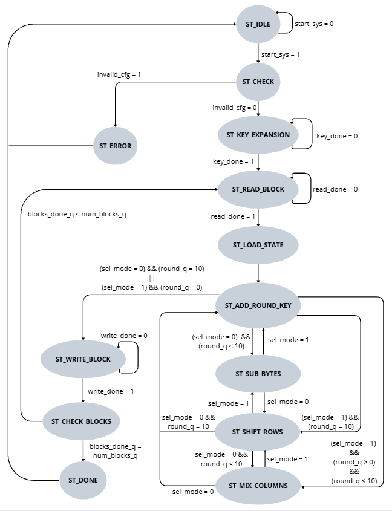
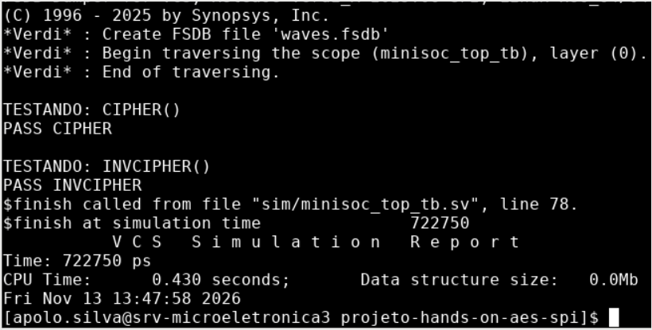
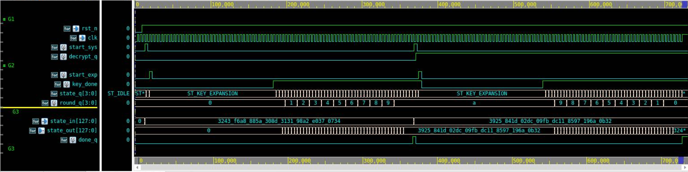

# Relatório da semana 04 — Expansão de chave e datapath AES-128

Nesta semana, foram implementados a expansão de chave e o datapath do AES-128. A cifragem e a decifragem foram verificadas em simulação no topo do núcleo AES.

## 1. Sequência de execução do AES-128

O AES-128 utiliza uma chave de 128 bits para processar blocos de 128 bits em 10 rodadas. Os algoritmos da FIPS 197 [1], apresentados na Figura 1, orientaram a revisão da FSM e a implementação do datapath.

*Figura 1 — Pseudocódigos de (a) cifragem, `CIPHER()`, e (b) decifragem, `INVCIPHER()`. Fonte: FIPS 197 [1], Algoritmos 1 e 3.*

A FSM revisada aguarda a expansão de chave e controla a sequência de operações nos dois sentidos (Figura 2).

*Figura 2 — FSM para cifragem e decifragem AES-128. Fonte: elaboração própria.*

### 1.1. Expansão de chave — `minisoc_aes_key_exp`

O módulo [`minisoc_aes_key_exp.sv`](../../rtl/minisoc_aes/minisoc_aes_key_exp.sv) segue o Algoritmo 2 da FIPS 197 [1]. As quatro primeiras palavras de 32 bits recebem a chave original. As 40 restantes são calculadas por XOR, com aplicação de `ROTWORD()`, `SUBWORD()` e `Rcon` a cada quatro palavras. A tabela de `Rcon` foi implementada com `case`.

A expansão reutiliza quatro S-boxes de `minisoc_aes_sub_bytes` e calcula uma palavra por ciclo, totalizando 40 ciclos de cálculo. `start_exp` inicia a operação e `key_done` sinaliza sua conclusão. As mesmas 11 chaves são usadas nos dois sentidos, com `round_q` selecionando a chave disponível em `round_key`.

## 2. Datapath AES-128

O módulo [`minisoc_aes_dp.sv`](../../rtl/minisoc_aes/minisoc_aes_dp.sv) instancia os blocos combinacionais `SubBytes`, `ShiftRows`, `MixColumns` e `AddRoundKey`. A cada ciclo de processamento, a FSM seleciona a transformação cujo resultado será armazenado no registrador de 128 bits `aes_state_q`.

A cifragem aplica as chaves de `K0` a `K10`, e a decifragem, de `K10` a `K0`. 

## 3. Testbench autoverificável

O testbench `minisoc_top_tb.sv` instancia `minisoc_aes_top` e verifica a cifragem e a decifragem de um bloco em modo ECB. O resultado é montado a partir das quatro palavras nas portas de escrita do topo e comparado ao valor do Apêndice B da FIPS 197 [1]. O testbench fornece o bloco de entrada já montado e emula os sinais de controle de memória pendentes.

O testbench também instancia `minisoc_pll_mock`, com referência de 2 GHz e divisor `/8`, gerando 250 MHz para o AES. Após a saída do reset, `o_locked` sobe na quarta borda de subida da referência. O reset do AES é liberado dois ciclos do clock de sistema depois [2].

As simulações no Icarus Verilog e no Verilator retornaram `PASS CIPHER` e `PASS INVCIPHER`. Resultados divergentes ou ausência de `DONE` geram `FAIL`. A compilação no Verilator foi concluída com avisos.

*Figura 3 — Resultado do testbench no terminal.*

*Figura 4 — Formas de onda da simulação no Verdi.*

## Referências

1. **NIST.** *Advanced Encryption Standard (AES).* FIPS 197. Washington, D.C., 2001. Atualizado em 9 maio 2023. DOI: [10.6028/NIST.FIPS.197-upd1](https://doi.org/10.6028/NIST.FIPS.197-upd1). Acesso em: 7 out. 2026.
2. **MiniSoC AES.** *DV_BlockGuide_MiniSoCAES*, v1.0.0. Especificação do projeto.
